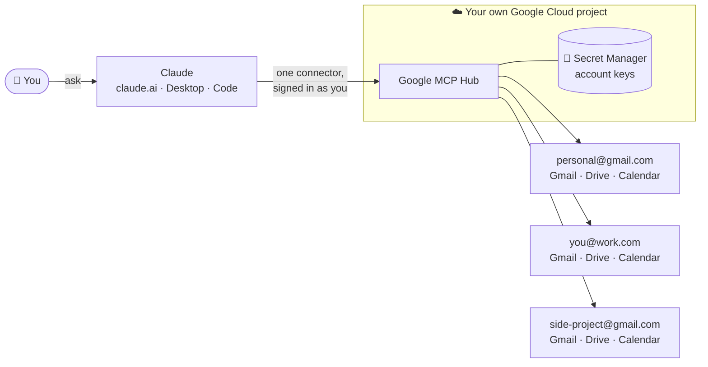
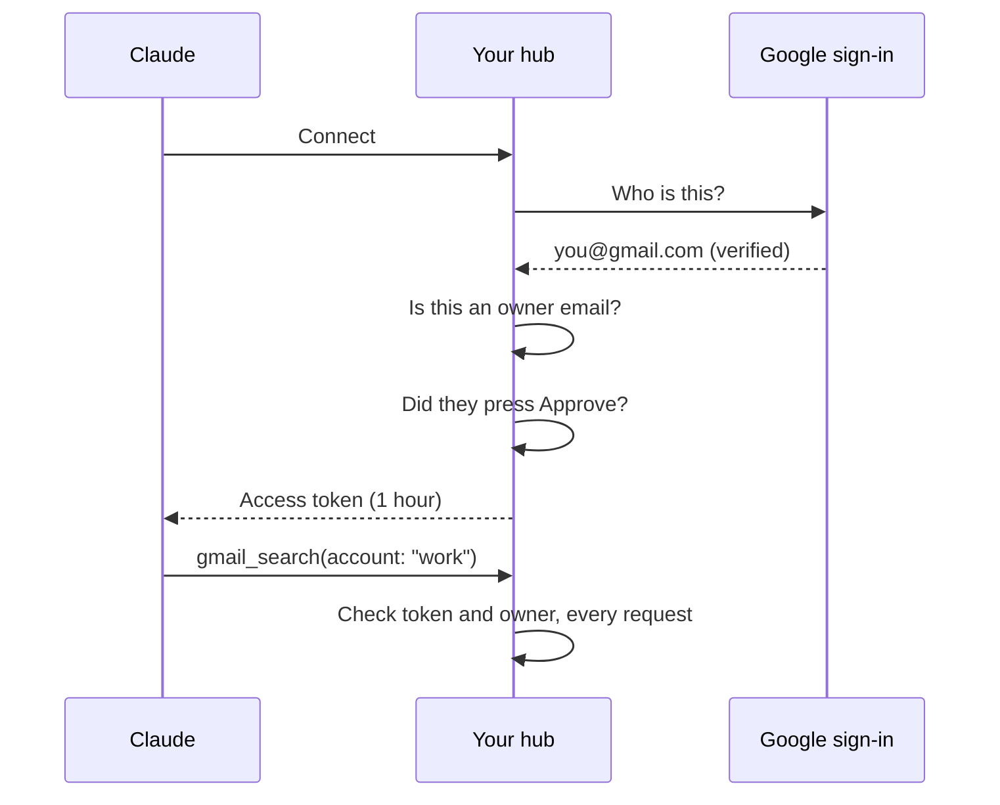

<div align="center">

<h1>Google MCP Hub</h1>

**Use all your Google accounts with Claude at once. Gmail, Drive and Calendar for your personal, work and side-project accounts, in one conversation.**

[](#deploy)
[](https://modelcontextprotocol.io)
[](#how-it-stays-private)
[](#what-it-costs)

</div>



## What you can do

- 📬 **Search every inbox at once.** *"Find the latest invoice in any of my accounts."*
- 🔀 **Work across accounts.** *"Read the contract email in my work account and save a summary as a Google Doc in my personal Drive."*
- 📅 **See all your calendars together.** *"What's on my calendars this week?"* or *"Find a free hour on Tuesday across all accounts."*
- 🏷️ **Group accounts with tags.** Tag two accounts `work`, then ask *"Check my work inboxes."*
- ✍️ **Draft, don't send.** Claude writes Gmail drafts and creates files and events. Nothing goes out without you.

> **Your data stays yours.** You run your own copy in your own Google Cloud account. Nobody else holds your keys or sees your email, not even the people who wrote this code.

<div align="center">

**⭐ Leave a star if you find this useful**

</div>

---

## Contents

- [What you need](#what-you-need)
- [Setup at a glance](#setup-at-a-glance)
- [Deploy](#deploy): the commands, for people comfortable with a terminal
- [Connect your accounts and Claude](#connect-your-accounts-and-claude)
- [Tools Claude gets](#tools-claude-gets)
- [How it stays private](#how-it-stays-private)
- [What it costs](#what-it-costs)
- [Run it locally](#run-it-locally)
- [Reference](#reference): settings, project layout, troubleshooting

> 🆕 **New to Google Cloud?** Follow the **[step-by-step setup guide](guides/getting-started.md)**. It assumes no experience and takes about 30 minutes.

---

# What you need

| You need | Why | Cost |
| --- | --- | --- |
| A **Google account** | To sign in to Google Cloud | Free |
| A **Google Cloud account** with billing turned on | The hub runs there. Google asks for a card even for free-tier use | About $0 a month for one person ([details](#what-it-costs)) |
| A **Claude account** on a plan with [custom connectors](https://support.anthropic.com/en/articles/11175166-getting-started-with-custom-connectors-using-remote-mcp) | Claude talks to the hub as a connector | Your existing plan |
| A **terminal with `gcloud`** | To run the deploy script | Free. [Cloud Shell](https://shell.cloud.google.com) has everything in your browser |

The Google accounts you connect can be any mix: personal Gmail, Google Workspace (work or school), or several of each.

---

# Setup at a glance

| Step | What you do | Time |
| --- | --- | --- |
| 1 | Create a Google Cloud project with billing | 5 min |
| 2 | Get the code and fill in `deploy.env` (project, region, your email) | 2 min |
| 3 | Run `./scripts/deploy.sh` once; it tells you what to set up next | 1 min |
| 4 | Create a Google sign-in client in the Cloud Console (the only manual step) | 5 min |
| 5 | Run `./scripts/deploy.sh` again; it deploys and prints your hub's address | 5 min |
| 6 | Open your hub, sign in, connect your Google accounts | 2 min |
| 7 | Add the hub to Claude as a custom connector | 1 min |

👉 Every click is spelled out in the **[step-by-step guide](guides/getting-started.md)**.

---

# Deploy

For people who already use `gcloud`. You need a project with billing enabled.

## Step 1 — Get the code and set your details

```sh
git clone https://github.com/rescueahero4/google-mcp-hub.git
cd google-mcp-hub
cp deploy.env.example deploy.env
```

Edit `deploy.env`:

```ini
PROJECT_ID=my-mcp-hub          # project IDs cannot contain the word "google"
REGION=us-central1             # pick one near you
OWNER_EMAILS=you@gmail.com     # the only Google account(s) allowed to use the hub
```

## Step 2 — First run

```sh
./scripts/deploy.sh
```

It enables the APIs, then stops and prints your hub's redirect URI with what to do next.

## Step 3 — Create the OAuth client

1. **Google Auth Platform → Get started.** Audience: **External**.
2. **Audience → Publish app**, so connected accounts don't expire after 7 days. See [Testing vs. In production](#testing-vs-in-production).
3. **Clients → Create client → Web application.** Add the redirect URI the script printed.
4. Put the client ID and secret in `deploy.env`:

```ini
GOOGLE_CLIENT_ID=1234-abc.apps.googleusercontent.com
GOOGLE_CLIENT_SECRET=GOCSPX-...
```

## Step 4 — Deploy

```sh
./scripts/deploy.sh
```

It creates two service accounts and three secrets, builds the image on Cloud Build and deploys to Cloud Run. Then it prints:

```
Hub:              https://google-mcp-hub-123456789.us-central1.run.app/
Claude connector: https://google-mcp-hub-123456789.us-central1.run.app/mcp
```

<details>
<summary>What the script creates</summary>

| Resource | Purpose | Permissions |
| --- | --- | --- |
| Cloud Run service `google-mcp-hub` | The hub. Scales to zero, max 1 instance | Public URL; the hub checks every request itself |
| Service account `hub-runtime` | Runs the hub | Read its 3 secrets; add versions to `hub-accounts`. Nothing project-wide |
| Service account `hub-builder` | Builds the image from source | `roles/run.builder` |
| Secret `hub-accounts` | Connected accounts and their Google refresh tokens | Old versions destroyed on every write |
| Secret `hub-signing-key` | Signs the hub's own tokens and sessions | Rotate to sign everyone out |
| Secret `hub-google-client-secret` | Your OAuth client secret | |

</details>

<details>
<summary>Updating to a new version</summary>

```sh
git pull
./scripts/deploy.sh --yes
```

Connected accounts and Claude connections survive updates.

</details>

<details>
<summary>Signing every Claude connection out</summary>

```sh
./scripts/deploy.sh --yes --rotate-signing-key
```

Every Claude app has to sign in and press **Approve** again. Connected Google accounts stay connected.

</details>

<details>
<summary>Removing everything</summary>

Delete the project if it only holds the hub:

```sh
gcloud projects delete my-mcp-hub
```

Or remove just the hub's parts:

```sh
gcloud run services delete google-mcp-hub --region us-central1
gcloud secrets delete hub-accounts
gcloud secrets delete hub-signing-key
gcloud secrets delete hub-google-client-secret
gcloud iam service-accounts delete hub-runtime@my-mcp-hub.iam.gserviceaccount.com
gcloud iam service-accounts delete hub-builder@my-mcp-hub.iam.gserviceaccount.com
```

Disconnect your accounts on the hub page first, so their access is also revoked at Google.

</details>

---

# Connect your accounts and Claude

## Connect Google accounts

1. Open your hub's address and sign in with your owner email.
2. Under **Connect an account**, pick an access level and click **Connect with Google**.
3. Choose the account in Google's chooser. You'll see *"Google hasn't verified this app"*. That's expected for your own private app: click **Advanced → Go to … (unsafe)**.
4. Repeat for each account.

| Field | Required | What it's for |
| --- | --- | --- |
| **Access** | Yes | `read-write` (default) or `read-only` |
| **Name** | No | A short name Claude can use. Defaults to the part of the email before `@` |
| **Tags** | No | Groups like `work` or `family`. Several accounts can share a tag |

You can rename, re-tag, reconnect or disconnect any account later from the same page.

## Connect Claude

| App | How |
| --- | --- |
| **claude.ai, Desktop, mobile** | Settings → Connectors → **Add custom connector** → paste `https://<your hub>/mcp` → sign in with Google → **Approve** |
| **Claude Code** | `claude mcp add --transport http google-hub https://<your hub>/mcp`, then `/mcp` to sign in |

Then try: *"List my connected Google accounts, then show the 3 latest emails in each."*

---

# Tools Claude gets

Every tool takes an `account`: the account's name or email.

| Area | Tool | What it does |
| --- | --- | --- |
| Accounts | `list_accounts` | Connected accounts with names, emails, tags and access |
| Gmail | `gmail_search` | Search with Gmail syntax, like `from:boss newer_than:7d` |
| | `gmail_read_message` | Read one message: headers, text and attachment list |
| | `gmail_create_draft` | Create a draft. **Never sends** |
| Drive | `drive_search` | Search file names and contents |
| | `drive_read` | Read a file as text. Docs come back as Markdown, Sheets as CSV |
| | `drive_create` | Create a file from text, optionally as a Google Doc or Sheet |
| Calendar | `calendar_list_calendars` | Calendars the account can see |
| | `calendar_list_events` | Events in a time range (default: next 7 days) |
| | `calendar_find_busy` | Busy times only, for finding a free slot across accounts |
| | `calendar_create_event` | Create an event. Guests are only emailed if you ask |

> **Working across accounts** is Claude reading with one account's tool and writing with another's. The hub never moves data between accounts on its own, and every step shows up in Claude.

---

# How it stays private



- 🔑 **Only you get in.** Signing in, connecting accounts and approving Claude all need a Google account listed in `OWNER_EMAILS`. Everyone else is refused.
- ✋ **You approve each Claude app.** After Google sign-in, the hub asks you to press **Approve** before Claude gets a token.
- 🧾 **Only Claude can register.** The hub accepts sign-in requests only from Claude's addresses (claude.ai, claude.com, and localhost for Claude Code).
- 🔐 **Keys live in Secret Manager.** Google refresh tokens are stored encrypted in one secret. The hub's runtime account can read only its own three secrets.
- 📝 **Logs without content.** Each tool call logs who, which account, which tool, how long and whether it worked. Never message text, search terms or tokens.
- ⚠️ **Email can contain tricks.** Text from emails and files is treated as untrusted, and Claude is told not to follow instructions inside it. For a hard guarantee, connect inbox-heavy accounts as `read-only`.

### Testing vs. In production

Google's **Publish app** button does **not** make your hub public or list it anywhere. It changes two things:

| | Testing | In production |
| --- | --- | --- |
| Who can pass Google's sign-in for your app | Only test users you add | Any Google account, after a warning |
| Connected accounts | **Expire every 7 days** | Stay connected |

Either way, the hub itself still refuses anyone who isn't an owner. Pick **In production** to avoid weekly reconnects, or stay in **Testing** (adding your own accounts as test users) for an extra layer from Google.

---

# What it costs

For one person, expect **$0 to about $1 a month**.

| Part | Why it's cheap |
| --- | --- |
| Cloud Run | Scales to zero; you pay only while a request runs |
| Secret Manager | Three small secrets, well inside the free tier |
| Cloud Build, Artifact Registry | A few minutes of build time and a small image per deploy |

Set a [budget alert](https://console.cloud.google.com/billing/budgets) (for example $5) so nothing surprises you. The first call after a quiet spell takes 1–3 seconds while the hub wakes up.

---

# Run it locally

For trying changes without deploying.

```sh
npm install
cp .env.example .env    # fill in an OAuth client and a 32+ character HUB_SIGNING_KEY
npm run dev             # http://localhost:8080
```

- Add `http://localhost:8080/oauth/google/callback` to your OAuth client's redirect URIs.
- Accounts are stored in `.data/accounts.json` (git-ignored).
- Test with [MCP Inspector](https://github.com/modelcontextprotocol/inspector) or `claude mcp add --transport http hub-dev http://localhost:8080/mcp`.
- `npm run typecheck` checks types. `npm run build` compiles to `dist/`.

---

# Reference

<details>
<summary>Settings (environment variables)</summary>

The deploy script sets these for you. You only set them yourself for local runs.

| Variable | Required | Meaning |
| --- | --- | --- |
| `BASE_URL` | Yes | The hub's public address |
| `OWNER_EMAILS` | Yes | Comma-separated Google emails allowed to use the hub |
| `GOOGLE_CLIENT_ID` | Yes | Your OAuth client ID |
| `GOOGLE_CLIENT_SECRET` | Yes | Your OAuth client secret |
| `HUB_SIGNING_KEY` | Yes | Random string, 32+ characters. Changing it signs everyone out |
| `STORE` | No | `file` (default, local) or `gcp` (Secret Manager) |
| `DATA_FILE` | No | Local account file. Default `.data/accounts.json` |
| `GCP_PROJECT` | With `gcp` | Project that holds the accounts secret |
| `ACCOUNTS_SECRET` | No | Secret name. Default `hub-accounts` |
| `ALLOWED_REDIRECT_URIS` | No | Comma-separated OAuth redirect URIs allowed to register. Default: claude.ai and claude.com |
| `ALLOW_LOOPBACK_REDIRECTS` | No | `false` blocks localhost clients such as Claude Code. Default `true` |
| `PORT` | No | Default `8080` |

</details>

<details>
<summary>Project layout</summary>

```
src/
  server.ts       routes (plain node:http, no framework)
  oauth.ts        sign-in for Claude: Google-gated, owner-only, stateless
  web.ts          the hub page: sign in, connect, rename, tag, disconnect
  accounts.ts     per-account Google access and friendly errors
  store.ts        account list: a JSON file locally, one secret on Google Cloud
  mcp.ts          builds the MCP server for each request
  tools/          one file per Google service
  scopes.ts       the two access levels
scripts/deploy.sh one-command deploy
guides/           step-by-step setup guide
```

Two runtime dependencies: [`@modelcontextprotocol/sdk`](https://github.com/modelcontextprotocol/typescript-sdk) and [`zod`](https://zod.dev). Google APIs are called with plain `fetch`.

</details>

<details>
<summary>Adding a Google service</summary>

1. Create `src/tools/<service>.ts` exporting `register<Service>Tools(ctx)`.
2. Register each tool with `ctx.tool(name, { title, description, input, readOnly }, handler)`.
3. In the handler, `await googleFor(ctx.user, account)` gives you a `fetch` signed in as that account.
4. Call it from `src/mcp.ts`, and add any new scopes to `src/scopes.ts`.

</details>

<details>
<summary>Troubleshooting</summary>

| Problem | Fix |
| --- | --- |
| Accounts need reconnecting every 7 days | Your OAuth app is in **Testing**. Publish it, or reconnect weekly |
| "Google hasn't verified this app" | Expected for a private app. **Advanced → Go to … (unsafe)** |
| `redirect_uri_mismatch` | The OAuth client's redirect URI must exactly match the one the script prints |
| Project ID rejected | Project IDs can't contain "google" |
| "You have exceeded your project quota" | Reuse an existing project, or [request more](https://support.google.com/code/contact/project_quota_increase) |
| Build fails reading sources (`storage.objects.get`) | Re-run the script; it sets up the `hub-builder` account that fixes this |
| `allUsers` / domain-restricted sharing error | Your organization blocks public services. Use a project outside the organization, or ask your admin |
| Work account can't connect | Your Workspace admin blocks outside apps. Ask them to trust your OAuth client ID |
| Claude doesn't see new tools | Start a new chat, or turn the connector off and on |
| Something else | Check the logs: Cloud Console → Cloud Run → `google-mcp-hub` → **Logs** |

</details>

---

## License

[Apache-2.0](LICENSE)
